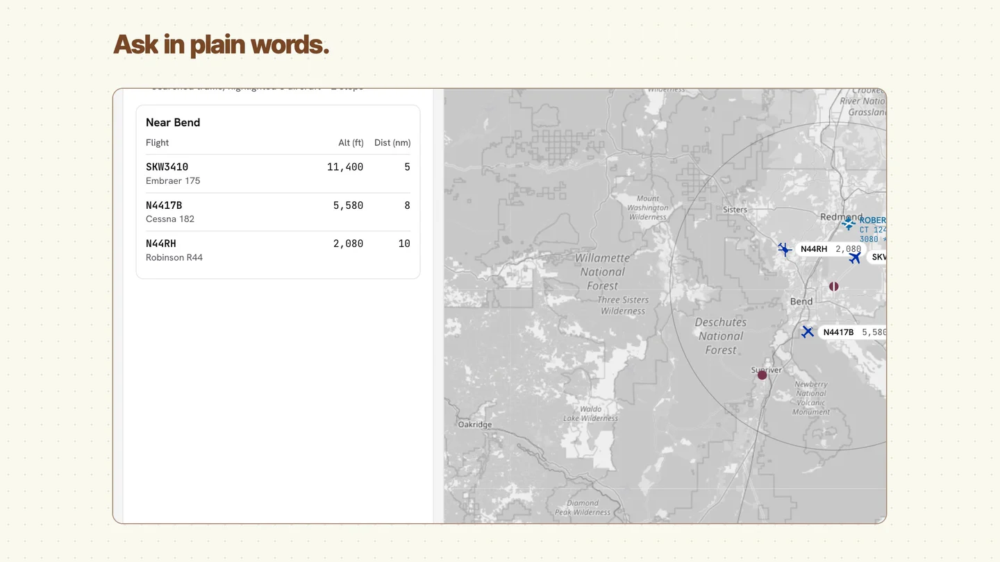
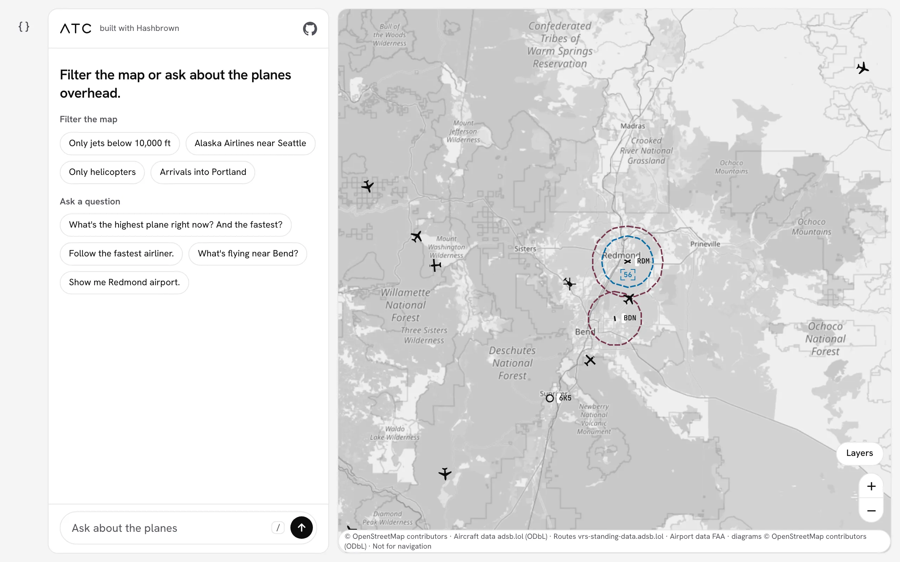
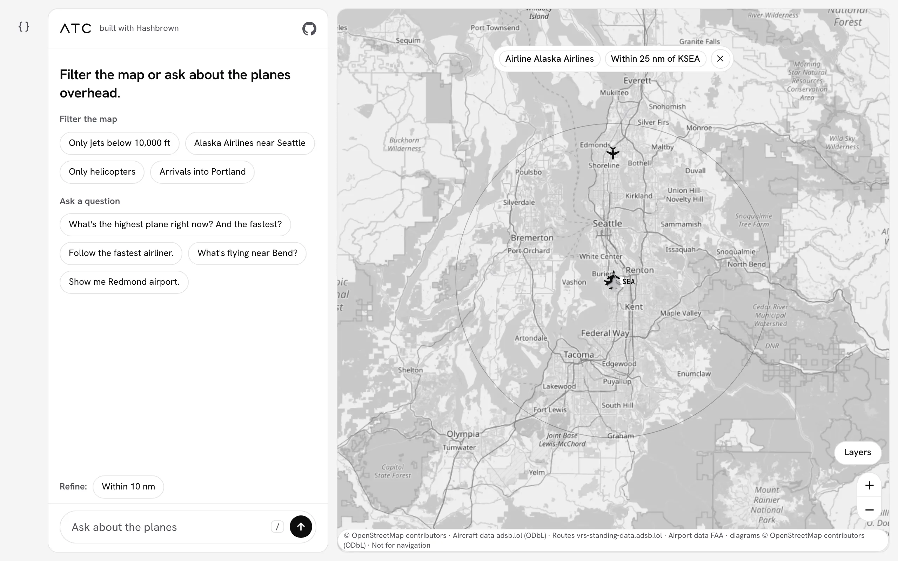
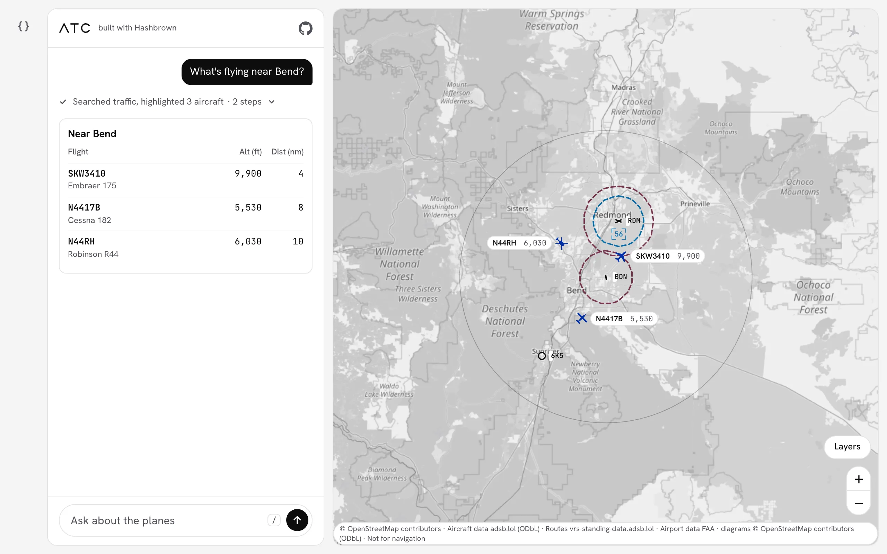
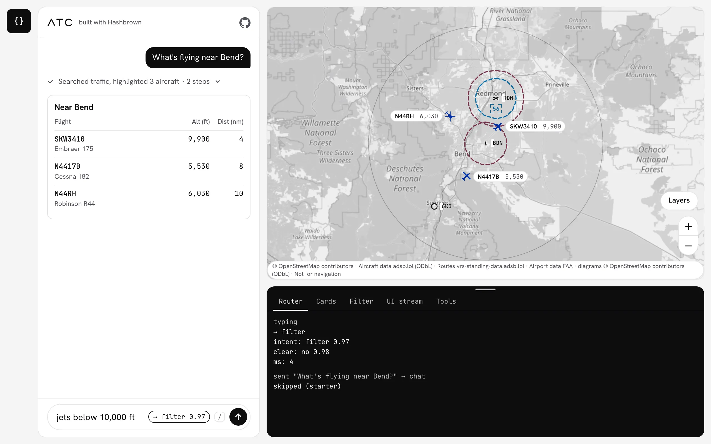

# atc

[](https://hashbrown.dev/blog/2026-10-10-building-atc)

_Watch the one-minute demo in the [blog post](https://hashbrown.dev/blog/2026-10-10-building-atc), or [fly atc live](https://atc.hashbrown.dev)._

atc is a live map of the air traffic over the Pacific Northwest, with an assistant that answers in the app's own components.
It's Hashbrown's flagship example, and it's built twice: once in Angular and once in React, on one shared, framework-free core.

If you only read two files, read the core files: [`angular/src/app/assistant.ts`](./angular/src/app/assistant.ts) and [`react/src/assistant.tsx`](./react/src/assistant.tsx).
Everything else is ordinary app code reading one store.

## What This Shows

atc shows Hashbrown in three steps.
You type into one composer, and a badge shows where Enter will send the text.

1. **Decide.** A TypeSafe Jev decision reads what you typed and routes it: to the map filter, to clearing the filter, or to the chat.
2. **Filter.** A filter request streams a structured `MapFilter` into a pill of chips, and the map dims every plane the filter hides.
3. **Generate.** A question goes to the chat, which calls tools in the browser and answers with Markdown and the app's own cards.

The chat opens with eight starters in two groups, four filters and four questions:



Pick "Alaska Airlines near Seattle" and the filter streams in as chips, the map moves to the area, and a "Refine:" row offers ways to narrow it:



Ask "What's flying near Bend?" and the answer is an `ArrivalsBoard`, a real component, with the planes highlighted on the map:



Finally, press the `{ }` button on the rail to open the developer drawer.
It shows each layer's JSON as it arrives for the newest send, in five tabs: Router, Cards, Filter, UI stream and Tools.
Here, the Router tab shows the decision for text that is still being typed:



Dev mode is off on a first visit, and the choice is remembered.
On phones, the button is in the header and the drawer opens as a sheet.
The drawer only reports; nothing in it changes the app.

## Run Locally

atc uses the Node version pinned by `.nvmrc`, an OpenAI API key, and optionally a TypeSafe API key. The optional b4.run backend requires Node 24 or newer.

```bash
git clone https://github.com/liveloveapp/hashbrown.git
cd hashbrown
nvm use
npm ci
```

Next, add your key to the `.env` file at the root of the repository:

```bash
OPENAI_API_KEY=sk-...
# Optional: enables the Decide step (see below).
TYPESAFE_API_KEY=...
```

Then, start the API server and one or both apps, each in its own terminal:

```bash
npx nx serve atc-server
```

```bash
npx nx serve atc-angular
```

```bash
npx nx serve atc-react
```

Open http://127.0.0.1:4341/angular/ or http://127.0.0.1:4342/react/.
The API server runs on http://127.0.0.1:4340, and both dev servers proxy `/api` to it.
There is no switcher between the two apps; they're the same app, built twice.

The server reads these variables, from `.env` or the environment:

| Variable                  | Default      | Notes                                                                                                                                                 |
| ------------------------- | ------------ | ----------------------------------------------------------------------------------------------------------------------------------------------------- |
| `ATC_CHAT_BACKEND`       | `openai`     | Select `openai` or `b4run`; unknown or empty values fail startup. |
| `OPENAI_API_KEY`          | none         | Required. The server will not start without it, even though the map alone needs none.                                                                 |
| `OPENAI_MODEL`            | `gpt-5-mini` | Any OpenAI model the Responses API serves.                                                                                                            |
| `OPENAI_BASE_URL`         | OpenAI       | For an OpenAI-compatible endpoint.                                                                                                                    |
| `OPENAI_REASONING_EFFORT` | `low`        | Sent to gpt-5 and o-series models only. Set it empty to send none. An unknown value stops the server at startup.                                      |
| `TYPESAFE_API_KEY`        | none         | Optional. Enables `/api/decide` (TypeSafe Jev). Without it, `/api/decide` answers 503 and atc sends everything you type to the chat, with every card. |
| `PORT`                    | `4340`       | The dev servers' `/api` proxy expects 4340.                                                                                                           |

## Choose the chat backend

`ATC_CHAT_BACKEND=openai` is the default locally and in the hosted build. Its
[`HashbrownOpenAI.stream.text` call](./server/src/run-handler.ts) remains the
direct provider example. Filters continue using Hashbrown's OpenAI provider
with either chat backend, so `OPENAI_API_KEY` is required in both cases.

To run chat through a b4.run agent instead:

```bash
ATC_CHAT_BACKEND=b4run npx nx serve atc-server
```

The framework applications still call `/api/run` with Hashbrown's own hooks and
transport. Hashbrown owns the components, streaming JSON, and tools that read and
change the browser's live map. The small
[agent descriptor](./server/src/b4run/agent.ts) gives b4.run the server-owned
prompt, model, 4096 output-token cap, and bounded execution. It permits no server
tools or delegation. b4.run parks browser calls and continues when Hashbrown
returns their results. The [adapter](./server/src/b4run/request.ts) pins all tool
definitions and translates Hashbrown's selected response schema into b4.run's
`forwardedProps.responseSchema`, including every continuation.

An unknown backend setting or a failed selected backend stops startup; there is
no fallback. `OPENAI_REASONING_EFFORT=max` is unsupported by the agent backend
and fails explicitly. Local agent state uses SQLite under `server/.b4/`.
A signed HttpOnly cookie identifies an anonymous visitor, and thread ownership
prevents another visitor from continuing that conversation. Reloading starts a
new conversation; no history restoration endpoint is exposed. Local signing
keys are ephemeral unless `ATC_B4RUN_COOKIE_SECRET` is set.

**Package compatibility:** the agent path requires a coherent b4.run package
set containing the browser-tool replay fixes and `agent({ maxOutputTokens })`.
The dependency pins are now `0.15.2`, installed and tested from the registry.
That release still drops `maxOutputTokens`; the agent fails startup rather than
dropping its cap. The passing agent/browser results used the patched local
package set recorded in the [compatibility report](../../docs/superpowers/reports/2026-10-23-atc-b4run-compatibility.md).
The output-cap and replay fixes are merged in [b4.run #1101](https://github.com/cacheplane/b4run/pull/1101).
Generated deployments also need the request-owned client-tool store fix in
[b4.run #1106](https://github.com/cacheplane/b4run/pull/1106). A release containing
both fixes, a dependency-pin update, and registry-package validation remain required.

### Optional hosted build

The regular `npx nx build atc` keeps the direct OpenAI function and requires no
agent storage settings. To package the optional agent instead:

```bash
ATC_CHAT_BACKEND=b4run npx nx build atc
```

The build precompiles the authored agent inputs into an ESM staging app, invokes
b4.run's public Vercel build target, and wraps its intact output with the guarded
ATC ingress. It verifies that wrapper from an isolated directory. The same seven
API functions and Angular hosting remain; no raw agent or thread endpoint is
published. The build never deploys or releases anything.

Set these variables on that deployment:

| Variable | Purpose |
| --- | --- |
| `ATC_CHAT_BACKEND=b4run` | Must match the packaged backend. |
| `ATC_B4RUN_COOKIE_SECRET` | A stable signing secret of at least 32 bytes, shared by every instance. |
| `ATC_B4RUN_DATABASE_URL` | Shared Postgres storage for checkpoints, threads, and pending browser calls, using the `atc` table prefix. |

The adapter maps the dedicated ATC state database into the generated runtime
without changing the process's general `DATABASE_URL`. Hosted startup never
falls back to ephemeral SQLite. Shared-store integration tests pass against a disposable local Postgres 17
instance. They exercise separate pools, checkpoint/thread visibility, partial
and duplicate results, failed tool-result persistence, and retryable cleanup.
With the compatible source packages, complete agent continuation and ownership
also pass across independent runtime pools. The generated Vercel artifact passes
continuation across two isolated module copies sharing Postgres, signed visitor
ownership, duplicate-result handling, pinned schema/output cap, and internal-route
denial. These source-package results must be repeated with the compatible release.
Deployed-host validation also remains required before hosting.

Run the opt-in store and runtime tests against a **disposable test database**:

```bash
ATC_TEST_DATABASE_URL=postgresql://... npx nx test-integration atc-server
```

After building the optional agent artifact, validate its Postgres boundary:

```bash
ATC_CHAT_BACKEND=b4run npx nx build atc
ATC_TEST_DATABASE_URL=postgresql://... npx nx test-artifact atc-server
```

The tests create ATC tables and prune expired pending-call records. Never point
this target at production or a database containing state you need to retain.

### Anonymous state cleanup

Browser calls expire after 10 minutes. Settled and expired call records have a
24-hour retention setting and are pruned opportunistically by the runtime.
Conversation admission ends 24 hours after creation; physical checkpoint and
thread deletion requires operator cleanup.

Disable admission and stop **every** agent instance, wait for all active runs to
settle across replicas, then run:

```bash
npx nx prune-agent-state atc-server --offline
```

Use the same `ATC_B4RUN_DATABASE_URL` for hosted state; omit it for local SQLite.
The flag affirms that the service is offline; the command does not acquire a
distributed lock. It deletes expired checkpoints before their thread rows, then
prunes old tool-call records through public storage APIs or `b4 client-tools
prune`. A failed deletion leaves its thread row available for retry. Rerun
cleanup while still offline before reopening admission. No scheduler is added;
physical retention depends on the operator running this command regularly.

## How This Example Is Built

Both core files are organized into the same numbered steps, so you can read them side by side.
Let's walk through each step, and where it lives.

| Step                    | What it does                                                                                                              | Where to look                                                                                                                                                                |
| ----------------------- | ------------------------------------------------------------------------------------------------------------------------- | ---------------------------------------------------------------------------------------------------------------------------------------------------------------------------- |
| 1. Expose components    | Four cards (`FlightCard`, `ArrivalsBoard`, `AircraftCompare`, `AirportCard`) plus Markdown, each with a Skillet contract. | `exposeComponent` in the core files; the contracts in [`shared/src/contracts.ts`](./shared/src/contracts.ts)                                                                 |
| 2. Give the model tools | Sixteen tools that search, highlight, follow and filter the aircraft already on the map. They run in the browser.         | [`shared/src/tools.ts`](./shared/src/tools.ts), [`shared/src/tool-definitions.ts`](./shared/src/tool-definitions.ts), `createTool` (Angular) and `useTool` (React)           |
| 3. Render the stream    | `uiChatResource` / `useUiChat` streams the answer and renders only the components you exposed.                            | The core files                                                                                                                                                               |
| 4. Decide               | The router decides where typed text goes. For a chat message, a second decision picks which cards fit.                    | [`angular/src/app/router.ts`](./angular/src/app/router.ts), [`react/src/router.ts`](./react/src/router.ts), and `uiDecisionResource` / `useUiDecision` in the core files     |
| Filter                  | A structured completion against `/api/filter` streams the `MapFilter` field by field.                                     | [`angular/src/app/filter.ts`](./angular/src/app/filter.ts), [`react/src/filter.tsx`](./react/src/filter.tsx), [`shared/src/find-aircraft.ts`](./shared/src/find-aircraft.ts) |
| Developer drawer        | The view model behind the five tabs, and the log of every send and the route it took.                                     | [`shared/src/dev-tool.ts`](./shared/src/dev-tool.ts), [`shared/src/stream-view.ts`](./shared/src/stream-view.ts), [`shared/src/route-log.ts`](./shared/src/route-log.ts)     |

A few things to note about the Decide step:

- The router asks once per typing pause (150 ms), and only for text of three characters or more. Shorter text goes to the chat when you press Enter.
- The cards decision keeps at most two cards, at 0.7 confidence or better. Below that, or if the decision fails, the chat gets every card.
- The starters skip the router: each one already knows whether it's a filter or a question.
- A failed or unsure decision never blocks a send.

And about the Filter step:

- The filter is app state (`AtcState.mapFilter`), not a chat message. A filter adds nothing to the transcript.
- A later filter request refines the current one, and so does a click on a "Refine:" suggestion. The suggestions ("Below 5,000 ft", "Only <airline>", "Within 10 nm", "Only jets") come from [`shared/src/refinements.ts`](./shared/src/refinements.ts): each keeps some of the matches and drops some, and they hold still while the planes move.
- Planes you point at (selected, highlighted or followed) are never dimmed.
- If a filter request fails, the map goes back to the filter it was refining, and the pill says so.

**One schema, four uses.** [`shared/src/find-aircraft.ts`](./shared/src/find-aircraft.ts) defines the filter fields once.
They're the `findAircraft` tool's arguments, the filter's streamed structured output, the arguments of `setMapFilter`, and the schemas the server pins.
One pure predicate applies a filter to an aircraft for both the map and `findAircraft`, so the map and the assistant always agree.

**Data flow.** [`shared/src/feed.ts`](./shared/src/feed.ts) polls `/api/aircraft` every 3 seconds, `store.applySnapshot` takes the snapshot, and the map and the components re-render.
The model's tools read the same store in the browser, so the server never sees the plane list.

**The server pins the model routes.** All three model routes are public, so the server decides what the model sees:

- `/api/run` replaces the system prompt, the tool definitions (with its own copies from `shared/src/tool-definitions.ts`) and the UI response schema, drops unknown tools, and caps the answer at 4,096 output tokens, the body at 256 KiB, and the messages at 100 of 16,000 characters each. The one thing a client may change is to narrow the cards: a schema that equals a pinned subset is kept, and anything else is replaced with the full one.
- `/api/filter` pins its own system prompt and `mapFilterSchema`, sends no tools, and caps the output at 512 tokens.
- `/api/decide?kind=route|cards` pins the questions and the decision context for each kind, and ignores the client's questions. Without `TYPESAFE_API_KEY` it answers 503.

[Securing a public endpoint](https://hashbrown.dev/docs/angular/recipes/public-endpoint) explains why, using this server as the worked example.

Here's the layout of the example:

```text
atc/
  shared/    Framework-free TypeScript used by both apps and the server
    src/          The store, tools, contracts, prompts, filter, router and drawer view models
    src/map/      The Leaflet map: markers, motion, data tags, detail card, follow pill
    src/chart/    Chart types, AIRAC cycle, parsing, runway geometry
    src/styles/   One stylesheet for both apps, as ordered partials
  angular/   The Angular app: thin components and the core file
  react/     The React app: the same, mirrored
  server/    /api/run, /api/filter, /api/decide, /api/aircraft and /api/chart/*
  e2e/       Playwright for both apps, the demo video recorder, and the live evals
  tools/     The Vercel build output
```

The map is pointer-only (planes are not keyboard-focusable), and every map action is also available from the chat.

### Add a Component

1. Add a contract (name, description, Skillet props) to `shared/src/contracts.ts`. Keep IDs as plain `s.string` so they're held back until complete.
2. Build its view model in `shared/src/views.ts`, and test it.
3. Write the Angular and React components and a fallback for each, and add them to the `cards` kit in both core files (`cardsKit` in `angular/src/app/assistant.ts`, `cards` in `react/src/assistant.tsx`).
4. Add the contract to `CARD_DEFINITIONS` in `shared/src/response-schemas.ts`, in the same position as in the kits. Skip it and any schema with the new card matches no pinned one, so the server falls back to the full schema, which doesn't include the card: the model can never render it.
5. Add it to the cards group of `cardGroups` in `shared/src/contracts.ts`, in the same position. The server pins the cards decision's questions from it; skip it and the decision never picks the card, so it's never offered.
6. Tell the model when to use it in `SYSTEM_PROMPT`, as a direct rule like the others ("show one AirportCard"). One line already covers turns that don't offer it.
7. Say when it fits in `CARDS_CONTEXT`, in one sentence like the others. The cards decision reads it with the descriptions; check the pick with `npx nx decide-eval atc-e2e`.

### Add a Tool

See the comment on `createAtcTools` in `shared/src/tools.ts`.
The tool's name, description and schema also go in `ATC_TOOL_DEFINITIONS` (`shared/src/tool-definitions.ts`), which the server sends to the model; a tool missing there is dropped.

## Tests and Evals

Build, test and lint everything:

```bash
npx nx run-many -t build,test,lint -p atc-shared atc-server atc-angular atc-react atc-e2e atc
```

Run the Playwright suite against both apps:

```bash
npx nx e2e atc-e2e
```

The e2e suite needs no keys and no network: [aimock](https://github.com/CopilotKit/aimock) scripts every model turn ([`e2e/src/model.ts`](./e2e/src/model.ts)), and [`e2e/src/stubs.ts`](./e2e/src/stubs.ts) serves synthetic traffic, the chart fixtures and scripted decisions.
`atc-e2e` has no `build` target, so `run-many` skips it there; `npx nx typecheck atc-e2e` runs `tsc` over the e2e code, which Playwright and Vitest run without type checking.

Two live evals check what the stubs can't, and cost a little per run:

```bash
npx nx decide-eval atc-e2e   # needs TYPESAFE_API_KEY; no servers
npx nx prose-eval atc-e2e    # needs OPENAI_API_KEY and the dev servers
```

Run `decide-eval` after changing `ROUTE_CONTEXT`, `CARDS_CONTEXT`, `routeSchema` or a card description, and `prose-eval` after changing `SYSTEM_PROMPT` or a component description.

## Demo Video

`npx nx demo atc-e2e` records the demo video and the home page loop into `dist/examples/atc/demo/`, with a contact sheet for review.
It's deterministic and keyless, like the e2e suite: aimock answers every question, synthetic traffic stands in for adsb.lol (with extra aircraft from `e2e/demo/traffic.ts`), and the chart fixtures stand in for the FAA data.
Map tiles stay live.
It needs ffmpeg, and it runs Chromium headed, off screen, because headless screencasts ignore the 2x device scale that keeps text crisp.

The storyboard (headlines, code panes and their marked lines, camera framings) is in `e2e/demo/storyboard.ts`, and `npx nx test atc-e2e` checks that every marked line still exists.
After a recording, `npx nx demo-publish atc-e2e` copies the posters into `www/public` and points `www/src/components/elements/atc-media.ts` at content-hashed Vercel Blob URLs.
Add `-- --upload` with `BLOB_READ_WRITE_TOKEN` and `VERCEL_TOKEN` set to upload the videos, or run the commands it prints.

## Swap the Model Provider

`server/src/run-handler.ts` uses `HashbrownOpenAI`.
To use another provider, install its adapter (for example `@hashbrownai/anthropic`), replace `HashbrownOpenAI.stream.text` with `HashbrownAnthropic.stream.text`, and set that provider's key and model.
`limitRequest` in the same file sets the OpenAI Responses request's `max_output_tokens` and `reasoning.effort`; rewrite it for the new provider's request shape, keeping the output cap.
`pinTools`, `pinResponseSchema` and `pinSystemPrompt` work on the AG-UI input and carry over unchanged, except that `pinResponseSchema` casts to the adapter's run input type (`OpenAIHashbrownRunAgentInput`; for example `AnthropicHashbrownRunAgentInput`).
`server/src/filter-handler.ts` uses the same adapter and `limitRequest`, so change it the same way.

## Hosting

Only the Angular app is hosted, at https://atc.hashbrown.dev/angular/ (the root redirects there).
The React app is built and tested in this repository but not hosted; `HOSTED_APPS` in `tools/build-vercel-output.mts` is the one line to change to host it.

`npx nx build atc` writes `.vercel/output`, with one function each for `/api/run`, `/api/filter`, `/api/decide`, `/api/aircraft`, `/api/chart/airports`, `/api/chart/surfaces` and `/api/chart/airspace`.
The hosted project (`hashbrown-atc`) needs:

- **`OPENAI_API_KEY`**: a dedicated OpenAI project key with a hard monthly budget.
- **`TYPESAFE_API_KEY`**: optional. Without it, `/api/decide` answers 503 and atc routes everything to the chat with all cards.
- **One Vercel Firewall rate-limit rule** on `POST /api/run` and `POST /api/filter`: 60 requests per minute per IP, shared between the two (fixed window, 429 above it). It's one rule because the Hobby plan allows one rate-limit rule per project. One question makes 3 to 5 `/api/run` requests, one per tool round trip, and a filter is one `/api/filter` request, so the shared budget is about ten questions a minute.
- **Nothing for `/api/decide`.** It caps itself in code at 300 requests per minute per IP, per server instance (a soft cap: instances count separately). The router asks once per typing pause and the cards decision once per chat turn, so a fast typist makes far more decisions than questions. A decision is one small TypeSafe call, capped at 4,000 characters of request.
- **A look at tile traffic.** Past light use, point `TILE_LAYER` at a commercial tile provider (see [Data and Attribution](#data-and-attribution)).

## Troubleshooting

**The server exits with `OPENAI_API_KEY is not set`.**
Add the key to the `.env` file at the repository root (not in `examples/atc`), or export it in your shell.
An unknown `OPENAI_REASONING_EFFORT` also stops the server at startup, with the value in the error.

**The map has no planes and says "Connecting to live traffic…", or the planes stop moving under "Traffic data delayed".**
Look at the `atc-server` terminal for `[atc] aircraft feed failed`.
adsb.lol answers 429 when one IP asks too often, and its anonymous API also has a daily quota per IP (about 500 requests at the time of writing).
The server asks at most once every 10 seconds per area while a tab is open, so an afternoon of development, evals and an open tab can use the quota up.
When that happens, adsb.lol keeps failing until the quota resets the next day.
The server serves the last snapshot for up to a minute, then `/api/aircraft` answers 502, and the app keeps the last planes it had.
Close tabs you aren't using, and lean on `npx nx e2e atc-e2e` and `npx nx demo atc-e2e`, which never call adsb.lol.

**The badge always says `→ chat`, and a filter you type goes to the chat.**
That's the Decide step without `TYPESAFE_API_KEY`: `/api/decide` answers 503, and atc falls back to the chat with every card.
Add the key and restart `atc-server`.
The filter starters still work without it, since they skip the router.

**`/api/run` or `/api/filter` answers 429 on the hosted app.**
That's the shared firewall rule above (60 a minute per IP).
Wait a minute, then try again.

**The apps load, but every `/api` call fails.**
The dev servers proxy `/api` to port 4340, so make sure `atc-server` is running there.
If you set `PORT` to something else, the proxy has nothing to talk to.

## Data and Attribution

- **Aircraft:** [adsb.lol](https://adsb.lol), under the [ODbL](https://opendatacommons.org/licenses/odbl/). The browser polls `/api/aircraft` every 3 s; the server shares one adsb.lol call per area across requests, reuses it for 10 s, pauses for 15 s after a 429, and serves the last good snapshot (marked `X-Atc-Stale: 1`) for up to 60 s when adsb.lol fails. Owner and operator fields are dropped on the server.
- **Routes:** scheduled routes come from [vrs-standing-data.adsb.lol](https://vrs-standing-data.adsb.lol). The browser fetches them directly, so adsb.lol sees the user's IP address for route lookups.
- **Map tiles:** [OpenStreetMap](https://www.openstreetmap.org/copyright) standard tiles, shown in grey. They're free for light use under the [OSM tile usage policy](https://operations.osmfoundation.org/policies/tiles/); a deployment with heavy traffic should point `TILE_LAYER` in `shared/src/map/tiles.ts` at a commercial tile provider.
- **Airports:** FAA NASR 28-day subscription (airports, runways, frequencies, tower hours) and FAA ADDS airport-mapping layers, both public domain. The server fetches them, caches them per AIRAC cycle and shares them through the CDN for a day.
- **Airport diagrams:** at airports without FAA mapping, taxiways, aprons and hold lines come from [OpenStreetMap](https://www.openstreetmap.org/copyright) through the Overpass API, under the [ODbL](https://opendatacommons.org/licenses/odbl/). `/api/chart/surfaces` serves that derived data under the same licence. The query is in `server/src/chart/upstream.ts`.
- **Airspace:** FAA ADDS Class Airspace (Class B, C, D and E surface areas), public domain. The server fetches it, keeps shelves within 250 nm of the map, caches it per AIRAC cycle and shares it through the CDN for a day. `/api/chart/airspace` serves it.
- **Not for navigation.** The chart is drawn in the style of a VFR sectional, in ink, but it isn't one. Don't use it to plan or fly a flight.

The `/api/chart/*` routes need no key, and each has its own Vercel function.
The map credits all of these in its attribution line.
The e2e tests stub `/api/aircraft` and `/api/chart/*` with synthetic data and block tiles and routes.

## For Coding Agents

Read [AGENTS.md](./AGENTS.md): the file map, the invariants not to break, and the commands to run before finishing.
